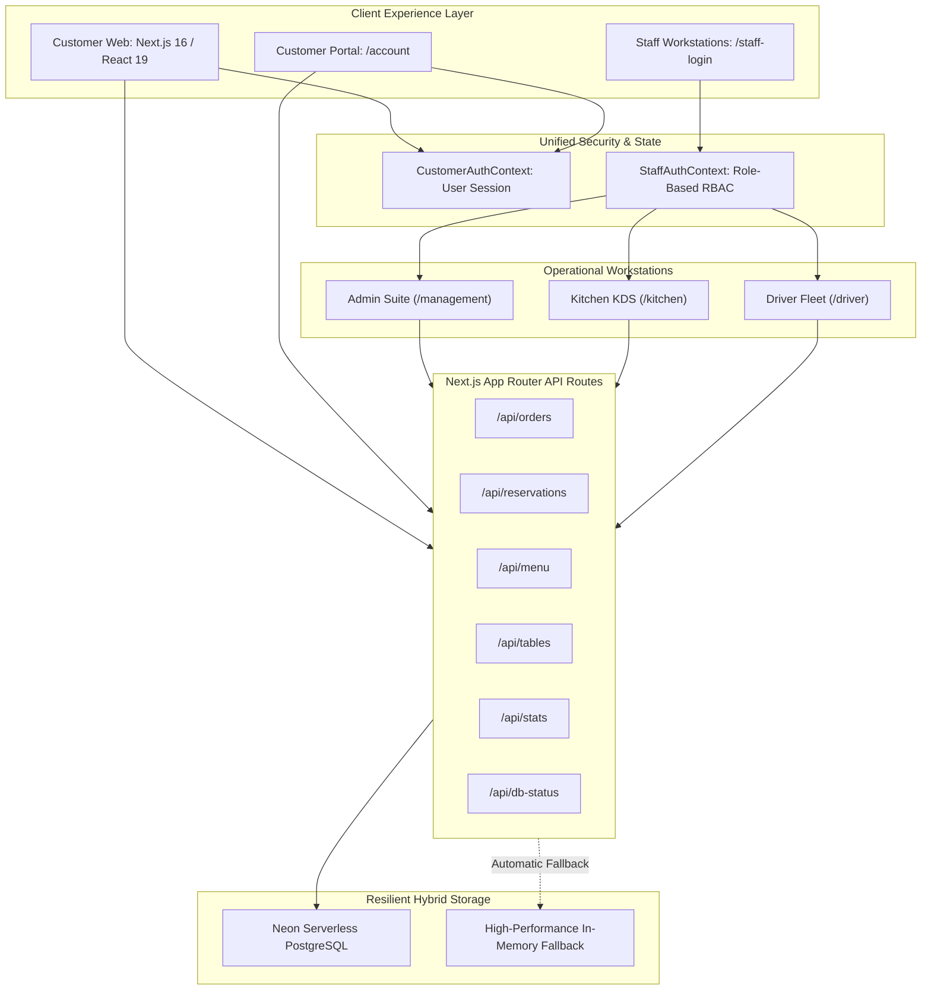

# 🍽️ Flavoria Restaurant & Hospitality Enterprise Suite

<div align="center">

[](https://aura-luxe-restaurant.vercel.app)
[](https://github.com/alvinmonir411/flavoria-restaurant)
[](https://nextjs.org/)
[](https://react.dev/)
[](https://www.typescriptlang.org/)
[](https://tailwindcss.com/)
[](https://neon.tech/)

**A full-stack, enterprise-grade restaurant management ecosystem and fine-dining digital experience platform.**  
Engineered for end-to-end hospitality operations: online dining & delivery, live Kitchen Display System (KDS), dispatch rider fleet management, synchronized multi-role staff access control, interactive table floor plans, and real-time analytics.

[Explore Live Demo](https://aura-luxe-restaurant.vercel.app) · [View Staff Portal](https://aura-luxe-restaurant.vercel.app/staff-login) · [Report Bug](https://github.com/alvinmonir411/flavoria-restaurant/issues)

</div>

---

## 📑 Table of Contents

- [Live Deployment & Quick Links](#-live-deployment--quick-links)
- [System Architecture](#-system-architecture)
- [Core Feature Matrix](#-core-feature-matrix)
  - [1. Guest & Customer Experience Platform](#1-guest--customer-experience-platform)
  - [2. Synchronized Authentication & Account Suite](#2-synchronized-authentication--account-suite)
  - [3. Multi-Role Staff Portal & Workstations](#3-multi-role-staff-portal--workstations)
  - [4. Operational Kitchen Display System (KDS)](#4-operational-kitchen-display-system-kds)
  - [5. Rider Fleet & Dispatch Portal](#5-rider-fleet--dispatch-portal)
  - [6. Executive Admin & Floor Management Suite](#6-executive-admin--floor-management-suite)
- [Enterprise Demo Credentials](#-enterprise-demo-credentials)
- [Technology Stack](#-technology-stack)
- [Database Schema & Resilience](#-database-schema--resilience)
- [Getting Started Locally](#-getting-started-locally)
- [Environment Variables](#-environment-variables)
- [Vercel Deployment Guide](#-vercel-deployment-guide)
- [Author & License](#-author--license)

---

## 🌐 Live Deployment & Quick Links

| Portal / Station | Description | Live Production URL |
| :--- | :--- | :--- |
| **Public Fine Dining Web** | Curated menus, chef storytelling, booking & cart | [aura-luxe-restaurant.vercel.app](https://aura-luxe-restaurant.vercel.app) |
| **Interactive Menu** | Full categorized menu, dietary filters & instant add | [aura-luxe-restaurant.vercel.app/menu](https://aura-luxe-restaurant.vercel.app/menu) |
| **Online Ordering** | Cart drawer, checkout, delivery & takeaway pipeline | [aura-luxe-restaurant.vercel.app/order](https://aura-luxe-restaurant.vercel.app/order) |
| **Table Reservations** | Real-time table selection with instant `FLV-XXXX` certificates | [aura-luxe-restaurant.vercel.app/reservation](https://aura-luxe-restaurant.vercel.app/reservation) |
| **Customer Dashboard** | VIP tier, order history, active bookings & saved addresses | [aura-luxe-restaurant.vercel.app/account](https://aura-luxe-restaurant.vercel.app/account) |
| **Staff & Admin Portal** | PIN keypad & role-based workstation authentication | [aura-luxe-restaurant.vercel.app/staff-login](https://aura-luxe-restaurant.vercel.app/staff-login) |
| **Kitchen KDS Station** | Live prep board with audio alerts & ticket advancement | [aura-luxe-restaurant.vercel.app/kitchen](https://aura-luxe-restaurant.vercel.app/kitchen) |
| **Driver Fleet Hub** | Real-time dispatch, turn navigation, cash drop collection | [aura-luxe-restaurant.vercel.app/driver](https://aura-luxe-restaurant.vercel.app/driver) |
| **Executive Management** | 360° analytics, floor plan grid, menu CRUD & DB diagnostic | [aura-luxe-restaurant.vercel.app/management](https://aura-luxe-restaurant.vercel.app/management) |

---

## 🏛️ System Architecture



---

## ⚡ Core Feature Matrix

### 1. Guest & Customer Experience Platform
- **Atmospheric Haute Gastronomie Design**: High-contrast, accessibility-audited luxury palette inspired by Michelin-starred culinary artistry.
- **Dynamic Digital Tasting Menu**:
  - Filter across Starters, Mains, Desserts, Signature Mocktails, and Caviar Selections.
  - Dietary safety tags: Vegetarian, Vegan, Gluten-Free, Halal, Nut-Free, Chef's Special.
  - Localized pricing in Bangladeshi Taka (**BDT ৳**) with dynamic item modifiers and custom chef instructions.
- **Table Reservation Engine**:
  - Real-time seat allocation across the *Main Dining Hall*, *Chef's Counter*, *Terrace Garden*, and *Private Wine Vault*.
  - Instant issuance of cryptographic reservation certificates (`FLV-XXXX`).
- **VIP Club & Loyalty Program**:
  - Point accumulation on every dine-in and online order.
  - Tiered membership statuses (*Silver*, *Gold*, *Elite VIP*).

### 2. Synchronized Authentication & Account Suite
- **Synchronized Context**: Navbar user pill reacts in real-time when signing in or out; zero page refresh discrepancies.
- **Customer Account Center**:
  - Live order tracking with progress bars (`Received` → `In Kitchen` → `Ready` → `Out for Delivery` → `Delivered`).
  - 1-click reorder functionality pre-populating the cart drawer.
  - Address book management for Dhaka delivery zones (Gulshan, Banani, Baridhara, Dhanmondi, Uttara).

### 3. Multi-Role Staff Portal & Workstations
- **Dual Verification Modes**:
  1. **High-Speed 4-Digit POS PIN Keypad**: Tailored for busy front-of-house staff, servers, and chefs.
  2. **Staff Email & Password**: Enterprise access for administrative, accounting, and general management personnel.
- **8 Distinct Role Definitions**:
  - 👑 **Owner**: Unrestricted enterprise visibility, financial audits, profit margins.
  - 📋 **Restaurant Manager**: Real-time floor occupancy, reservation overrides, shift monitoring.
  - 👨‍🍳 **Executive Chef**: Menu item 86'ing (stock control), recipe costs, ticket pacing.
  - 🍳 **Kitchen Staff**: Active ticket queues, station filters, preparation timing.
  - 🛵 **Delivery Staff**: Geolocation routing, proof of delivery, cash collection reconciling.
  - 💳 **Order Manager**: Payment status confirmation, invoice generation, discount approvals.
  - 📦 **Inventory Manager**: Stock count monitoring, low-inventory alerts, supplier manifests.
  - 📊 **Accountant**: Daily gross/net revenue calculations, tax & VAT breakdowns, payment method ledger.

### 4. Operational Kitchen Display System (KDS)
- **4-Lane Real-Time Ticket Board**:
  - *Incoming / Queued* → *Cooking / Prep* → *Plating & Pass* → *Served / Dispatched*.
- **Station-Specific Filtering**:
  - Hot Kitchen, Grill, Cold Larder / Salad, Pastry & Dessert, Beverage Bar.
- **Audio Prep Bell**: Web Audio synthesized chime notifying line cooks whenever a new order is received.

### 5. Rider Fleet & Dispatch Portal
- **Turn-by-Turn Delivery Manifest**:
  - Customer contact details, delivery address, special drop notes, and itemized receipts.
- **Cash-on-Delivery (COD) Reconciliation**:
  - Direct ledger tracking cash amounts collected by each driver before end-of-shift drop-off.
- **1-Tap Status Transitions**:
  - Accept delivery → Mark as Picked Up → Delivered with customer confirmation.

### 6. Executive Admin & Floor Management Suite
- **Visual Table Grid**:
  - Color-coded dining tables (Available, Occupied, Reserved, Sanitizing).
  - 1-click seating transitions and party assignment.
- **Menu Management (Full CRUD)**:
  - Create, update, or decommission menu items with images, price, and category.
  - Instant stock switch (**"In Stock"** vs **"86'd / Sold Out"**).
- **Diagnostics & Data Recovery**:
  - Real-time Neon PostgreSQL connection telemetry.
  - 1-click database re-seeding and SQL schema migration runner.

---

## 🔑 Enterprise Demo Credentials

For quick evaluation and review, the platform provides pre-configured role shortcuts and passcodes:

### Staff Portal Credentials (`/staff-login`)

| Role | Default PIN | Email Login | Access Level |
| :--- | :---: | :--- | :--- |
| **Owner** | `1111` | `owner@flavoria.com` | Full Administrative & Financial |
| **Restaurant Manager** | `2222` | `manager@flavoria.com` | Floor, Reservations & Operations |
| **Executive Chef** | `3333` | `chef@flavoria.com` | Kitchen KDS, Menu CRUD & 86 Items |
| **Kitchen Staff** | `4444` | `kitchen@flavoria.com` | Kitchen Display System Station |
| **Delivery Driver** | `5555` | `driver@flavoria.com` | Rider Dispatch & Cash Drops |
| **Order Manager** | `6666` | `orders@flavoria.com` | POS Order Processing & Invoicing |
| **Inventory Manager**| `7777` | `inventory@flavoria.com` | Stock Levels & Ingredient Manifests |
| **Accountant** | `8888` | `finance@flavoria.com` | Financial Reports, Taxes & Ledgers |

> 💡 **Quick Demo:** On the `/staff-login` screen, simply tap any role pill at the bottom to test authentication instantly.

### Customer Account (`/account`)
- **VIP Customer**: `alvin@example.com` (Pass: any 4+ characters or click *"Sign In as Alvin Monir"*).

---

## 🛠️ Technology Stack

```
Frontend Architecture:
├── Framework: Next.js 16 (App Router, Server & Client Components)
├── UI Runtime: React 19
├── Language: TypeScript 5
├── Styles & Design System: Tailwind CSS v4 + PostCSS
├── Iconography: Lucide React (High-density SVG icon pack)
└── Audio Synthesis: HTML5 Web Audio API (Kitchen alerts)

Backend & Persistence:
├── API Layer: Next.js API Routes (Serverless Functions)
├── Primary Database: Neon Serverless PostgreSQL (@neondatabase/serverless)
├── Connection Fallback: Zero-Latency Resilient In-Memory Reactive Cache
└── Data Validation: Strict TypeScript Interfaces & Contracts

Tooling & Deployment:
├── Package Manager: npm
├── Code Versioning: Git & GitHub CLI (gh)
├── Cloud Platform: Vercel Production Global Edge Network
└── Localization: Bangladesh Time (BST / UTC+6) & Currency (BDT ৳)
```

---

## 🗄️ Database Schema & Resilience

Flavoria uses a **fault-tolerant hybrid storage engine** located in `src/lib/db.ts`:
1. When a valid `DATABASE_URL` is detected, it connects directly to Neon Serverless PostgreSQL over pooled SSL.
2. If running offline or without credentials, it automatically engages the high-performance in-memory fallback pre-populated with realistic Dhaka restaurant data.

### PostgreSQL Table Architecture
```sql
-- Dining tables floor map
CREATE TABLE IF NOT EXISTS tables (
  id TEXT PRIMARY KEY,
  table_number INT NOT NULL,
  capacity INT NOT NULL,
  status TEXT NOT NULL DEFAULT 'available',
  current_guest TEXT,
  updated_at TIMESTAMP DEFAULT CURRENT_TIMESTAMP
);

-- Food & beverage menu
CREATE TABLE IF NOT EXISTS menu_items (
  id TEXT PRIMARY KEY,
  name TEXT NOT NULL,
  category TEXT NOT NULL,
  price NUMERIC NOT NULL,
  description TEXT,
  image_url TEXT,
  in_stock BOOLEAN DEFAULT TRUE,
  dietary_tags TEXT[],
  created_at TIMESTAMP DEFAULT CURRENT_TIMESTAMP
);

-- Table reservations
CREATE TABLE IF NOT EXISTS reservations (
  id TEXT PRIMARY KEY,
  guest_name TEXT NOT NULL,
  guest_email TEXT NOT NULL,
  guest_phone TEXT NOT NULL,
  party_size INT NOT NULL,
  reservation_date DATE NOT NULL,
  reservation_time TEXT NOT NULL,
  seating_area TEXT NOT NULL,
  status TEXT DEFAULT 'confirmed',
  special_requests TEXT,
  created_at TIMESTAMP DEFAULT CURRENT_TIMESTAMP
);

-- Kitchen, dine-in & delivery orders
CREATE TABLE IF NOT EXISTS orders (
  id TEXT PRIMARY KEY,
  order_type TEXT NOT NULL,
  status TEXT NOT NULL DEFAULT 'received',
  items JSONB NOT NULL,
  total_amount NUMERIC NOT NULL,
  customer_name TEXT,
  customer_phone TEXT,
  delivery_address TEXT,
  assigned_driver_id TEXT,
  created_at TIMESTAMP DEFAULT CURRENT_TIMESTAMP
);
```

---

## 💻 Getting Started Locally

### 1. Prerequisites
- **Node.js** 18.17+ or 20+ (tested on Node.js 24)
- **npm**, **pnpm**, or **yarn**
- **Git**

### 2. Clone the Repository
```bash
git clone https://github.com/alvinmonir411/flavoria-restaurant.git
cd flavoria-restaurant
```

### 3. Install Dependencies
```bash
npm install
```

### 4. Configure Environment
Create a `.env.local` file in the root directory:
```bash
cp .env.example .env.local
```

### 5. Launch the Development Server
```bash
npm run dev
```

Visit [http://localhost:3000](http://localhost:3000) in your browser.

---

## 🔐 Environment Variables

| Variable | Required | Default | Purpose |
| :--- | :---: | :--- | :--- |
| `DATABASE_URL` | Optional | *In-Memory Fallback* | Neon Serverless PostgreSQL connection string |
| `NEXT_PUBLIC_APP_URL` | Optional | `http://localhost:3000` | Canonical app URL for absolute metadata |
| `PORT` | Optional | `3000` | Port for production server |

---

## 🚀 Vercel Deployment Guide

Deploying Flavoria to Vercel requires just one command or a simple Git import:

### Option A: Using the Vercel CLI
```bash
# Log in to your Vercel account
npx vercel login

# Deploy directly to production
npx vercel --prod --yes
```

### Option B: Automatic GitHub Integration
1. Go to your [Vercel Dashboard](https://vercel.com/dashboard).
2. Click **"Add New"** → **"Project"**.
3. Select the repository **`alvinmonir411/flavoria-restaurant`**.
4. *(Optional)* Add your `DATABASE_URL` under Environment Variables.
5. Click **"Deploy"**. Vercel will automatically build and publish the latest commit from `main`.

---

## 👨‍💻 Author & Contributions

- **Repository**: [github.com/alvinmonir411/flavoria-restaurant](https://github.com/alvinmonir411/flavoria-restaurant)
- **Live Site**: [aura-luxe-restaurant.vercel.app](https://aura-luxe-restaurant.vercel.app)
- **Engineered by**: Alvin Monir ([alvinmonir@gmail.com](mailto:alvinmonir@gmail.com))

Contributions, feature suggestions, and bug reports are welcome via [GitHub Issues](https://github.com/alvinmonir411/flavoria-restaurant/issues).

---

## 📄 License

This project is licensed under the **MIT License** — feel free to customize and deploy it for your own hospitality venues.
